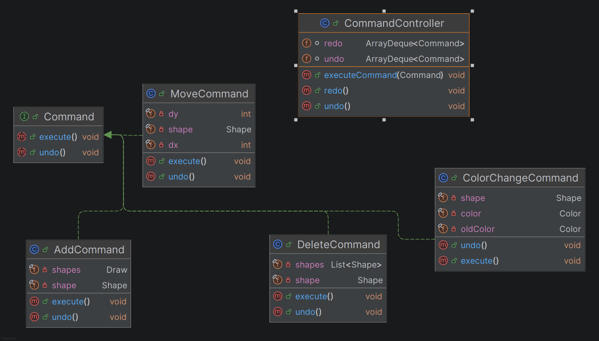

# DrawingProgram

A simple vector drawing application written in Java with Swing. Shapes are drawn with the mouse, can be colored, and every change can be undone and redone.

## Features

- **Drawing tools:** line, rectangle, circle and triangle, chosen from the toolbar (`JToolBar`). The default tool is the line.
- **Live preview:** while dragging, the shape follows the mouse; it is added to the drawing when the button is released.
- **Color picker:** the **Color** button opens a `JColorChooser`; new shapes are drawn in the chosen color.
- **Undo / Redo:** toolbar buttons and keyboard shortcuts, registered with `KeyStroke` + `InputMap` / `ActionMap`:
  - `Ctrl+Z` – undo
  - `Ctrl+Y` – redo

## Requirements

- JDK 25
- Maven 3.9 or newer

## Build and run

In IntelliJ IDEA, open the project and run `frames.DrawFrame.main()`.

From the command line:

```bash
mvn compile
java -cp target/classes frames.DrawFrame
```

## Running the tests

```bash
mvn test
```

In IntelliJ IDEA: right-click `src/test/java` → **Run 'All Tests'**.

The tests use no UI at all. They run directly on the `Draw` model and the command layer (11 tests in total):

- **`CommandControllerTest`** (5 tests) – uses a small counter command to check the controller alone: execute, undo, redo, a redone command can be undone again, a new command clears the redo history, LIFO order, and undo/redo on empty stacks.
- **`CommandsTest`** (6 tests) – runs the real commands on a `Draw`: adding and undoing, deleting with the shape restored at its original index, moving and moving back, changing color and restoring the previous one, redo, and clearing redo after a new command.

## Project structure

```
src/main/java
├── command      Command, CommandController and the concrete commands
├── factories    ShapeFactory, Tool
├── frames       DrawFrame – the window, toolbar and shortcuts
├── model        Draw – the drawing (list of shapes)
├── panels       DrawPanel – mouse handling and painting
└── shapes       Shape and its subclasses, Point
src/test/java
├── command      CommandControllerTest
└── model        CommandsTest
```

## Architecture

The model, the view and the control logic are kept separate.

- **Model – `Draw`:** holds the list of shapes and offers `add`, `remove`, `indexOf` and a read-only `getShapes()`. It does not depend on Swing, which is what makes the tests possible without a UI.
- **View – `DrawPanel.paintComponent`:** redraws every shape in `Draw`, then the preview shape if there is one.
- **Control – mouse handlers, toolbar and `CommandController`:** every change to the drawing goes through a command.

### Shapes

`Shape` is an abstract class with a color and three abstract methods: `draw(Graphics2D)`, `contains(Point)` and `move(dx, dy)`.

| Class | Stored as | `contains` |
|---|---|---|
| `Line` | two end points | distance to the segment is at most 4 px (`Line2D.ptSegDist`) |
| `Rectangle` | four corners, sorted upper-left → upper-right → lower-right → lower-left | compares the point with the opposite corners |
| `Circle` | center and radius | distance to the center is at most the radius |
| `Triangle` | three points (rejects collinear points) | sign of the cross product for each edge |

`Point` is the project's own mutable point class (`getX`/`getY`, `setX`/`setY`), not `java.awt.Point`.

### Design patterns

**Command** – every change is an object implementing `Command` with `execute()` and `undo()`:

- `AddCommand` – adds a shape to the drawing; undo removes it.
- `DeleteCommand` – removes a shape and remembers its index; undo puts it back at the same position, so the drawing order is kept.
- `MoveCommand` – moves a shape by `dx`, `dy`; undo moves it back.
- `ColorChangeCommand` – saves the shape's current color, then sets the new one; undo restores the saved color.

The values needed for undo (the index, the old color) are saved in `execute()`, not in the constructor, so they are correct again after every redo.

`CommandController` keeps two stacks. Executing a command pushes it onto the undo stack and clears the redo stack; undo moves the command to the redo stack, and redo moves it back. `canUndo()` and `canRedo()` report whether either stack has anything in it.

At the moment only `AddCommand` is used from the UI. `DeleteCommand`, `MoveCommand` and `ColorChangeCommand` are implemented and covered by the tests, ready for a selection tool.

**Factory** – `ShapeFactory.create(tool, start, end)` turns the selected `Tool` and the two mouse points into the matching shape, so `DrawPanel` does not need to know how each shape is built:

- **Line:** from `start` to `end`.
- **Rectangle:** `start` as a corner, with the horizontal and vertical distances as width and height.
- **Circle:** `start` as the center, the distance to `end` as the radius.
- **Triangle:** an upright triangle inside the dragged box (apex at the middle of the top edge).

### How drawing works

1. `mousePressed` stores the start point.
2. `mouseDragged` creates a preview shape in the selected color and repaints.
3. `mouseReleased` creates the final shape and adds it through an `AddCommand`, so it can be undone. Shapes the constructors reject, such as a flat triangle, are ignored.
4. `paintComponent` draws every shape in `Draw`, then the preview.

## UML

Class diagram of the command layer:


